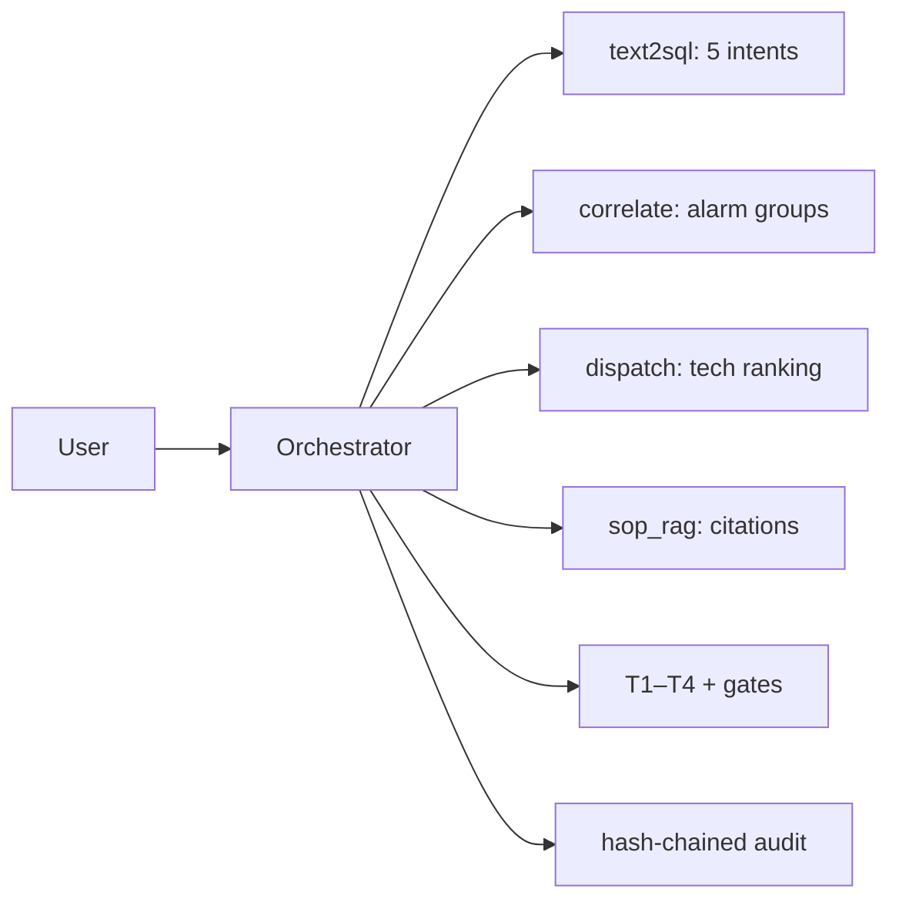

# Telecom Incident Agents

> **Recruiter summary.** A single fiber cut can raise a hundred alarms in
> minutes while the real fault hides in the noise. This repo is an
> end-to-end network-operations agent: it answers governed questions over
> NOC telemetry, correlates alarm storms into incidents with a transparent
> explanation per group, recommends field techs by skill + proximity + load,
> grounds procedural answers in SOPs with citations, and gates mass-outage
> declarations and SLA credits behind human confirmation. Proof:
> **55 tests green** (regression checks on synthetic data), a deterministic
> anchor (a 12-alarm LINK-DOWN storm on NE-CORE-01 correlated into one
> critical group), and a hash-chained audit log whose tamper detection is
> tested.

**Purpose.** A portfolio showcase of agentic AI applied to telecom network
operations — built for hiring managers and clients evaluating agentic
engineering depth, and for engineers adopting the patterns
(see `docs/implementation-guide.md`).

## Problem → approach → outcome

- **Problem.** Alarm storms bury the NOC: dozens of alarms, one fault.
  Dispatch is by gut feel, SLA clocks slip quietly, and nobody can explain
  after the fact why a tech was sent where.
- **Approach.** A ReAct planner over governed telemetry: five NL intents
  map to fixed SELECT templates over four read-only views (SELECT-only
  gateway with cited rule IDs); an alarm-correlation engine groups storms
  with explanations; a dispatch recommender scores skilled techs; a TF-IDF
  SOP retriever cites policy excerpts; a fiber-maintenance feed degrades to
  an explicit gap; T1–T4 tiers and confirmation gates guard risky actions.
- **Outcome.** Cited answers ("which incidents are at SLA risk?" → the
  exact incidents and targets), one incident per storm instead of twelve
  alarms, a ranked dispatch shortlist, and a tamper-evident audit trail.

## How this differs from coldchain/retail

The coldchain and retail repos share the same FDE spine (governed
text-to-SQL, SOP RAG, escalation tiers, hash-chained audit). What exists
*only* here:

- **Alarm-correlation engine** (`telcoops/correlate.py`) — groups raw
  alarms by element, site, cause-code affinity (checked in both directions)
  and time window with union-find, with a per-group explanation. Neither
  sibling repo has event correlation; cold-chain and retail act on one
  record at a time.
- **Dispatch recommender** (`telcoops/dispatch.py`) — skill-filtered,
  proximity- and load-scored tech ranking with explanations.
- **SLA clocks as first-class data** — restoration targets per severity
  with breach detection, not just escalation tiers.
- **Explicit-gap external feed** — the fiber-maintenance feed refuses to
  hallucinate when unconfigured.

## Architecture

See [`knowledge/architecture.md`](knowledge/architecture.md) (Mermaid) and
[`knowledge/domain-notes.md`](knowledge/domain-notes.md) for the domain
background.



## Modules

| Module | What it does |
|---|---|
| `telemetry.py` | Seeded SQLite NOC data (deterministic anchors) |
| `views.py` | 5 read-only views + SELECT-only gateway (SEC-SELECT-01/02/03/04; 04 = views only via SQLite authorizer) |
| `text2sql.py` | 5 intents, one simplified retry, then `EscalationNeeded` |
| `correlate.py` | **Differentiator:** alarm-correlation engine with explanations |
| `dispatch.py` | **Differentiator:** skill/proximity/load tech recommender |
| `fibersignal.py` | Fake fiber-maintenance feed + live stub with explicit gap |
| `sop_rag.py` | TF-IDF SOP retrieval with `file §section` citations |
| `orchestrator.py` | ReAct planner with multi-intent fan-out |
| `escalation.py` | T1–T4 tiers + confirmation gates (mass outage, SLA credit) |
| `audit.py` | Hash-chained log with `verify_chain()` |
| `feedback.py` | Thumbs/corrections, PII-scrubbed before storage |
| `demo_helpers.py` | Stdlib demo logic (tested) |

## Real run

```
$ python -m pytest tests/ -q
55 passed

$ python -c "from telcoops import demo_helpers; print(demo_helpers.demo_correlation())"
{'group_count': 6, 'storm_group': 'CG-001', 'storm_alarms': 12, 'storm_severity': 'critical'}

$ python -c "from telcoops import demo_helpers; print(demo_helpers.demo_dispatch()['tech_id'])"
TECH-001
```

The seeded storm (12 LINK-DOWN alarms on NE-CORE-01 inside 10 minutes)
correlates into exactly one critical group; the remaining 5 open alarms
stay as singletons — nothing is dropped.

## How to run

```bash
python -m pytest tests/ -q        # offline, stdlib only
pip install streamlit && streamlit run demo/app.py   # thin demo UI
```

## Guardrails and security controls

- SELECT-only gateway with cited rule IDs; literals stripped before the
  write-keyword scan (no false positives on quoted text); views only
  (SQLite authorizer, ADR 0001); 100-row cap enforced at fetch time.
- Mass-outage declarations and SLA-credit approvals require human
  confirmation (`ConfirmationGate`).
- Feedback free text is PII-scrubbed (email/phone/SSN) before storage;
  redaction counts are recorded.
- Error paths never echo row data; the live feed returns explicit gaps.
- See [`docs/threat-model.md`](docs/threat-model.md) (STRIDE-lite).

## Limitations and known failures

- The 55 tests are **regression checks on synthetic data**, not quality
  claims about real networks.
- Correlation uses hand-tuned cause affinity; real networks need affinity
  mined from historical tickets (`docs/implementation-guide.md`).
- No live model runs here — the planner is deterministic; model wiring is
  the deployment step.
- `LiveFiberFeed` is a stub; the site-distance map is illustrative.

## Standardization review (2026-10-18)

Reviewed against the portfolio standard after the build. Bugs found and fixed, each now pinned by a test:

1. **Correlation depended on arrival order.** `CAUSE_AFFINITY` lists FIBER-CUT -> LINK-DOWN but not the reverse, and `_linked` only looked it up from the earlier alarm. A LINK-DOWN raised 3 minutes before a FIBER-CUT at the same site stayed two incidents; the other order made one. Affinity is now checked both ways (output below shows both orders).
2. **The correlation engine was capped at 100 open alarms.** It loaded alarms through the planner gateway, whose 100-row cap would silently drop alarms in a large storm, against the "nothing is dropped" claim. Engine reads now go through a new `v_open_alarm_sites` view without the planner cap.
3. **PII scrubber missed `(555) 123-4567`.** The phone pattern needed a word boundary before `(`; replaced with a lookbehind pattern that also takes a `+1` prefix.
4. **Gateway had no view allowlist.** It blocked writes but any base table or `sqlite_master` was readable through the planner path, and a caller-supplied `LIMIT 100000` skipped the 100-row cap. New rule `SEC-SELECT-04` is enforced by a SQLite authorizer (`authz.py`, ADR 0001), and rows past 100 are never fetched.

Differentiator on the seeded data (regenerated and checked by CI on every push):

<!-- run: python scripts/show_differentiator.py -->
```text
{'group_count': 6, 'storm_group': 'CG-001', 'storm_alarms': 12, 'storm_severity': 'critical'}
TECH-001 has skill 'fiber-splicing'; 90 km from SITE-WEST (proximity 0.36); current load 20%
FIBER-CUT then LINK-DOWN: 1 group(s): A1~A2 (same site SITE-NORTH with affinitive causes FIBER-CUT/LINK-DOWN)
LINK-DOWN then FIBER-CUT: 1 group(s): A1~A2 (same site SITE-NORTH with affinitive causes LINK-DOWN/FIBER-CUT)
```
<!-- /run -->

Test count (also checked by CI):

<!-- run: python scripts/count_tests.py -->
```text
55 tests collected
```
<!-- /run -->

## Built / Written-not-run / Planned

| Status | Item |
|---|---|
| Built | Telemetry, views+gateway, text2sql, correlation engine, dispatch recommender, fiber feed (fake+gap), SOP RAG, orchestrator, escalation+gates, audit, PII-scrubbed feedback, demo, docs |
| Built | CI on every push: ruff, tests, docs drift check, hashed brand check, gitleaks; CodeQL; Dependabot |
| Planned | Live fiber-feed adapter, historical affinity mining, golden eval set in CI |

## Knowledge

- [`knowledge/domain-notes.md`](knowledge/domain-notes.md) — distilled NOC
  operations notes
- [`knowledge/architecture.md`](knowledge/architecture.md) — Mermaid
  architecture and data flow

## Related repos

Same FDE spine, different domains:
[Jagadish-coldchain-logistics-agents](https://github.com/jagadishmazure-jpg/Jagadish-coldchain-logistics-agents),
[Jagadish-retail-ops-agents](https://github.com/jagadishmazure-jpg/Jagadish-retail-ops-agents),
[Jagadish-healthcare-ops-agents](https://github.com/jagadishmazure-jpg/Jagadish-healthcare-ops-agents),
[Jagadish-insurance-underwriting-agents](https://github.com/jagadishmazure-jpg/Jagadish-insurance-underwriting-agents),
[Jagadish-warehouse-ops-agents](https://github.com/jagadishmazure-jpg/Jagadish-warehouse-ops-agents).

---

*All telemetry, people, companies, and maintenance providers are
fictional and synthetic. This is an independent portfolio project, not
affiliated with any carrier or vendor.*
