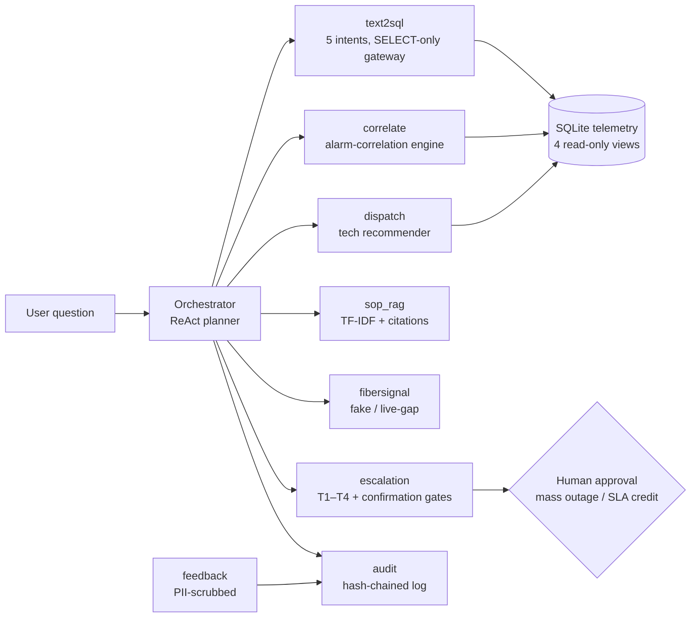

# Architecture

## Data flow
1. The orchestrator fans a question out to the matching tools.
2. `text2sql` answers governed questions over four read-only views; the
   gateway enforces SELECT-only with cited rule IDs.
3. `correlate` groups open alarms into incidents with a transparent
   explanation per group.
4. `dispatch` ranks on-shift, skilled techs by proximity and load.
5. `sop_rag` grounds procedural answers in the four SOPs with citations.
6. `fibersignal` adds third-party maintenance context, or an explicit gap.
7. T1–T4 tiers route the answer; gated actions wait for a human.
8. Every step lands in the hash-chained audit log, including user feedback.
